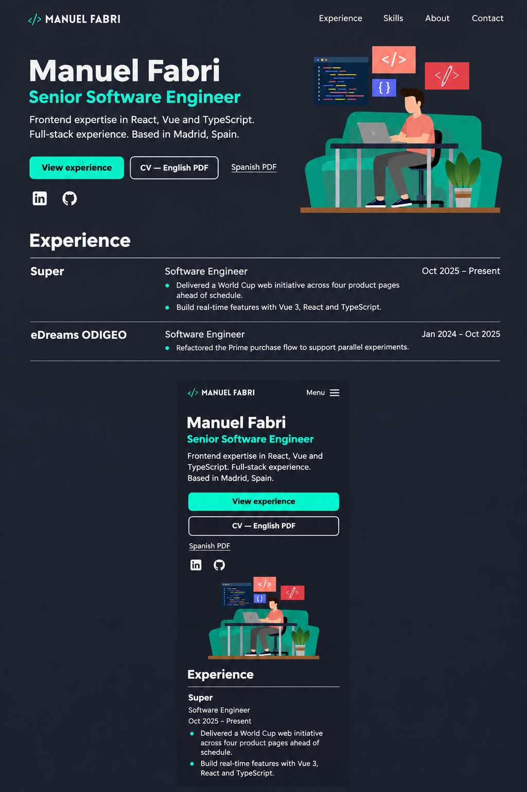

# Portfolio Experience and UX Refresh

Approved on 27 November 2026 for [manuelfabri.com](https://www.manuelfabri.com/).

## Goal

Help recruiters understand Manuel's senior software engineering profile, assess his achievements, download the current CV and contact him.

## Approved direction

Use proposal 1's illustrated layout and experience-first order with proposal 3's warmer introduction: “Hi, I'm Manuel Fabri.” The user explicitly approved this combination without another generated preview.

The image shows abbreviated content. The complete approved career history belongs on the page. Reuse the original developer illustration and portrait, with flat charcoal surfaces and turquoise accents. Do not reproduce generated artwork or incidental mock-up text.

## Content and visitor journey

- Introduce Manuel as a Senior Software Engineer with frontend expertise in React, Vue and TypeScript and hands-on full-stack experience, based in Madrid.
- Show View experience and clearly labeled English and Spanish PDF links near the introduction, with LinkedIn and GitHub as secondary links.
- Follow the introduction with the full reverse-chronological experience. Preserve the CV's titles, dates, exact bullets, distinction between shared and individual work, client aliases and qualitative outcome limits.
- Replace skill-percentage bars with the approved skill categories. Follow with About, education, languages and Contact.
- Keep the website in English. Spanish is a CV download, not a website language switch.
- Serve the original approved PDFs from `public/cv/`, with matching download links at Contact.
- Update browser and social metadata to the approved positioning.

The approved experience and skills are represented in `src/content/profile.ts`. The approved English and Spanish CVs are `public/cv/Manuel_Fabri_CV_EN.pdf` and `public/cv/Manuel_Fabri_CV_ES.pdf`. The English PDF is the source of truth for career facts; do not add numbers or responsibilities to strengthen the copy.

## Implementation boundaries

Retain Vue, TypeScript, Vite, the existing visual dependencies and GitHub Pages. Keep `#home`, `#about`, `#resume` and `#contact` links working. No CMS, contact form, backend, analytics service or new projects section is included.

The mobile menu must use native keyboard-operable controls, expose its current state, close after selecting a section and close on Escape with focus returned to the toggle. Section headings must remain visible below the sticky header.

Provide one H1, ordered section headings, a main landmark, a skip link, accessible social-link names, visible focus, sufficient contrast and reduced-motion support. The page must remain usable at 320px width and 200% zoom.

## Work and verification

1. Centralize approved career content and add the two original PDF assets. Compare their hashes with the source files.
2. Apply the approved responsive layout to the existing sections. Review the full desktop and mobile pages against the selected visual direction.
3. Correct navigation, keyboard behavior, focus, heading structure, motion preferences and metadata.
4. Verify the production build, types, lint, existing unit tests and the recruiter journey in the configured browsers. Check PDF downloads, narrow and wide layouts, zoom and keyboard operation. Perform code review and resolve actionable defects.

## Delivery

Use one feature branch and finish with one open PR targeting `main`. Include before/after screenshots and the validation results. Do not merge or manually trigger deployment; the existing workflow publishes on a push to `main`.
